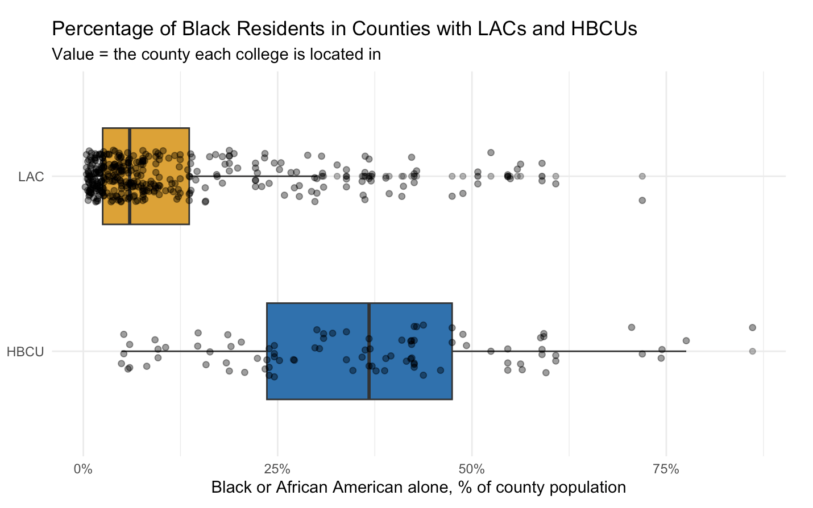
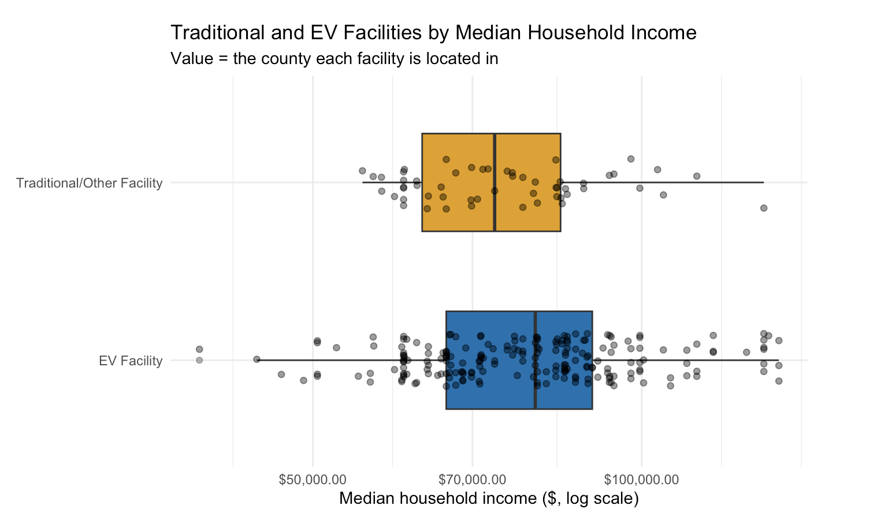
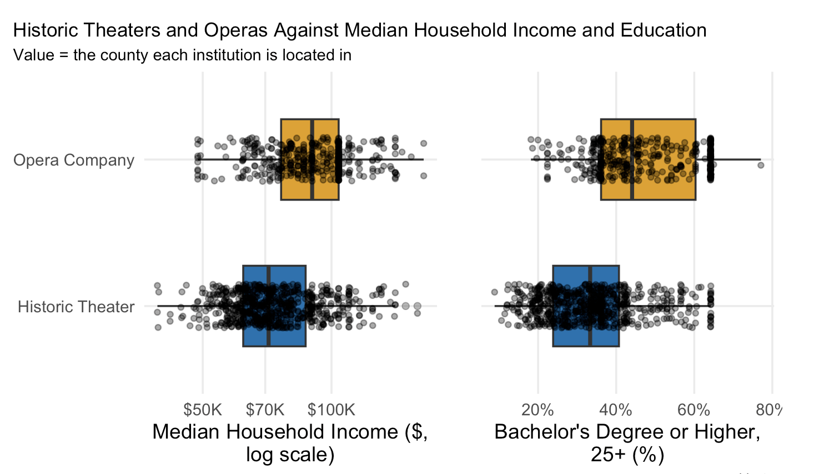

# Trends in Mapping American Institutions Against U.S. Census Data
##### Rimona Zhang 

 

During the course of this project, I focused on four cultural and economic institutions across the U.S. (colleges, automotive facilities, historic theaters, opera companies) and their relation to county-level Census data (2020–2024 ACS 5-year estimates via IPUMS NHGIS). Inspired by prior readings, my group members, and personal curiosity, I choose these institutions in hopes of exploring patterns in their geographic mapping and their surrounding demographic data. Each institution is plotted at its physical location and layered over counties shaded by a Census variable (racial demographics, median household income, educational attainment). But beyond locating where these institutions are on a map, I sought to find out how their broader geography might illuminate which populations are served, and the greater historical context behind each one.

 

## Colleges

When analyzing the mapped data across colleges, there is a noticeable difference between liberal arts colleges (LACs) and historically Black colleges and universities (HBCUs): their geographic locations. Specifically, HBCUs are located predominantly in the South, whereas LACs are scattered across the Northeast, Midwest, South, and West Coast.

In further analysis using US Census county data, counties with HBCUs have a significantly higher average percentage of Black or African American residents (~37%) compared to the average percentage in counties with LACs (~5%). While this pattern may seem apparent, as HBCUs would be most prevalent in areas with higher percentages of Black populations, this trend also carries significant historical context.

Prior to the American Civil War (1861-65), the first HBCUs were founded in Pennsylvania, DC, and Ohio. Although slavery was illegal in the North, racial discrimination against the education of Black Americans remained common; thus, only a few HBCUs were established. After the end of the Civil War and the abolition of slavery, the federal Freedmen’s Bureau operated throughout the Reconstruction Era to aid formerly enslaved people. In the South, where segregation and inequality were most prevalent toward Black people, institutions that would become HBCUs facilitated access to education. Today, many remain as vital institutions that provide higher education for Black students and archives of U.S. history.

To summarize, populations across counties with HBCUs tend to have more Black residents on average than counties with LACs. A question to consider for future research might be why there are few HBCUs located in the Northeast and Midwest, despite those regions having large Black populations both before and during the Great Migration (1910-1970)?

 

## Automotive & EV Facilities

After shading counties by average median household income, it’s revealed that EV facilities skew slightly higher than counties with traditional/other automotive facilities. Geographically, traditional facilities cluster in the Midwest and South, following patterns of America’s past in auto-manufacturing. In contrast, EV facilities are scattered more broadly across the country, appearing along the West Coast, Northeast, Midwest, and South.

This regional difference distinguishes two economic paths. On one end, traditional facilities largely follow the geography of the 20th-century auto industry: Detroit and the surrounding Rust Belt, plus the South’s recent development of manufacturing plants led by lower labor costs and tax incentives. On the other end, EV facilities follow a newer, more dispersed map, revealing influence over where they are being bought and serviced rather than their historical ties to the past. Furthermore, coastal metro areas with higher incomes, stronger EV adoption rates, and state-level incentive programs are all additional factors that help to establish this trend.

The distinction between facilities holds significance in its suggestion that the transition of EV manufacturing depicts a different mapping from the automotive patterns of the past—one that is driven toward higher-income, higher-density regions rather than the traditional manufacturing belt.

A future direction to continue from this finding could be asking whether the income gap between EV and traditional facility counties is driven more by consumer affordability, or by where infrastructure investment and state incentives are concentrated. In either circumstance, this map is sure to change as EV adoption develops throughout states.

 

## Theaters and Operas

Looking between counties with historic theaters vs. opera companies, regions with operas tend to have a higher average median household income than those with theaters. For both historic theaters listed in the National Register of Historic Places (NRHP) and members of the League of Historic American Theatres (LHAT), the range for median income for these counties vary around $70,000. In comparison, counties with opera companies and their associate organizations are noticeably higher, averaging above $70,000 across the members and ranging from nearly $77,500 to just over $100,000.

Another distinguishable difference appears when examining education. Specifically, the average percentage of county residents 25 and older with a bachelor’s degree or higher is around 32-34% for counties with historic theaters, compared to approximately 41-65% for counties with opera companies.

Between these differences is a deeper look into each art form's institutional history. In particular, theaters listed on the NRHP hold a spectrum of cultural stories for American towns and cities, with many beginning as neighborhood movie palaces or vaudeville houses meant for the working-/middle-class population. The preservation and record of these locations today reflect the significant local history tied back to these communities. In contrast, opera has often been associated with more elite patronage. Opera houses were historically built and sustained by wealthy benefactors, and this legacy of high-income, highly educated donor and audience bases continues to appear where opera companies are located and supported today.

Altogether, future analysis may address whether these differences reflect disparities of access in “prestigious” arts institutions like opera, compared to the more geographically and socioeconomically democratic footprint of historic theaters. Also, examining whether opera companies at the lower end of the income range—near $77,500—differ meaningfully in size, funding, or community outreach from those in the highest-income counties could be another path to pursue.

 

### Sources:

**Colleges**

-   [britannica.com-Historically Black Colleges and Universities](https://www.britannica.com/topic/historically-black-colleges-and-universities)
-   [hbcufirst.com-HBCU History Timeline](https://hbcufirst.com/resources/hbcu-history-timeline)
-   [journals.openedition.org](https://journals.openedition.org/qds/4044)
-   [archives.gov-The Great Migration](https://www.archives.gov/research/african-americans/migrations/great-migration)

**Automotive Facilities**

-   [motorcities.org-Southwest Detroit Auto Heritage Guide](https://www.motorcities.org/southwest-detroit-auto-heritage-guide/early-auto-boom)
-   [recurrentauto.com-States Leading the EV Revolution](https://www.recurrentauto.com/research/states-leading-the-ev-revolution)

**Theaters and Operas**

-   [americantheatre.org-Going National: How America's Regional Theatre Movement Changed the Game](https://www.americantheatre.org/2015/06/16/going-national-how-americas-regional-theatre-movement-changed-the-game/)
-   [lib.guides.umd.edu](https://lib.guides.umd.edu/historictheaters/theater-history)
-   [researchguides.library.vanderbilt.edu](https://researchguides.library.vanderbilt.edu/c.php?g=69054&p=449679)
